# [DiFaReli++: Diffusion Face Relighting with Consistent Cast Shadows](https://diffusion-face-relighting-pp.github.io/) (TPAMI 2026)
### [Puntawat Ponglertnapakorn](https://puntawatp.github.io/), [Nontawat Tritrong](https://scholar.google.com/citations?user=2txp4s0AAAAJ&hl=en), [Supasorn Suwajanakorn](https://www.supasorn.com/)

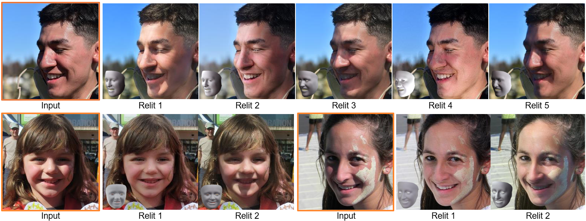


---

## Overview

- [1. Prerequisites](#1-prerequisites)
  - [1.1 Conda Environments](#11-conda-environments)
  - [1.2 Checkpoints](#12-checkpoints)
- [2. Preparing the Data for Inference](#2-preparing-the-data-for-inference)
  - [2.1 Step 1: Place Raw Input Images](#21-step-1-place-raw-input-images)
  - [2.2 Step 2: Run Dataset Preprocessing (`create_dataset.py`)](#22-step-2-run-dataset-preprocessing-create_datasetpy)
  - [2.3 Step 3: Compute Smooth Spatial Shadow Maps (`gen_smooth_Sdiff.py`)](#23-step-3-compute-smooth-spatial-shadow-maps-gen_smooth_sdiffpy)
- [3. Inference (`inference.py`)](#3-inference-inferencepy)
  - [3.1 Reshadowing (Strengthen Shadow & Diffuse Shadow)](#31-reshadowing-strengthen-shadow--diffuse-shadow)
  - [3.2 Rotate SH Lighting (`rotateSH`)](#32-rotate-sh-lighting-rotatesh)
  - [3.3 Target-SH Relighting (`targetSH`)](#33-target-sh-relighting-targetsh)
  - [3.4 CLI Arguments & Output Structure](#34-cli-arguments--output-structure)
- [4. Training (`TRAINING.md`)](#4-training)

---

## 1. Prerequisites

### 1.1 Conda Environments

Exported Conda environment files are provided in [`envs/`](envs/):

```bash
# 1. Sampling / Inference environment (also used by DECA & face-parsing in create_dataset.py)
conda env create -f envs/difareli_pp_sampling.yml

# 2. Dataset creation environment (ArcFace, DiffAE shadow score, MediaPipe pupil extraction)
conda env create -f envs/difareli_pp_create_dataset.yml

# 3. FFHQ face alignment environment
conda env create -f envs/ffhq_env.yml -p ./dataset_generation/prepare_relighting_data/FFHQ_align/ffhq_env

# 4. Training environment (optional)
conda env create -f envs/difareli_pp_training.yml
```

Install the local `guided_diffusion` package in editable mode inside `difareli_pp_sampling` (and `difareli_pp_training`):

```bash
conda activate difareli_pp_sampling
pip install -e .
```

---

### 1.2 Checkpoints

1. **DiFaReli++ Checkpoints**: Download the pretrained checkpoints from **[this link](https://vistec-my.sharepoint.com/:f:/g/personal/puntawat_p_s19_vistec_ac_th/IgBH7bjXhjx4RYoVJErshKgrARGUXzCkubt90jIUTG5IsjQ?e=JYR2W1)** and place `ImgCond_ema_0.9999_300000.pt` and `ImgEncoder_ema_0.9999_300000.pt` into `<path_to_ckpt>/DiFaReli++/`.
2. **Off-the-Shelf Pretrained Weights (for Data Preparation & Conditioning)**: Download the pretrained weights from their official sources—[DECA](https://github.com/yfeng95/DECA) & [FLAME](https://flame.is.tue.mpg.de/), [Diff-AE](https://github.com/phizaz/diffae), [Face Parsing](https://github.com/zllrunning/face-parsing.PyTorch), [ArcFace](https://github.com/foamliu/InsightFace-v2/tree/e07b738adecb69b81ac9b8750db964cee673e175), [FFHQ Align (dlib)](http://dlib.net/files/shape_predictor_68_face_landmarks.dat.bz2), and [MediaPipe](https://ai.google.dev/edge/mediapipe/solutions/vision/face_landmarker) and place them in the target directories below (only `diffae/shadow_cls_weight.pkl` is included directly in this repository).

<details>
<summary><b>📂 Click to expand checkpoint & off-the-shelf model directory structure</b></summary>

| Model | Source / Download | Required Files | Target Directory |
| :--- | :--- | :--- | :--- |
| **DiFaReli++** | [SharePoint](https://vistec-my.sharepoint.com/:f:/g/personal/puntawat_p_s19_vistec_ac_th/IgBH7bjXhjx4RYoVJErshKgrARGUXzCkubt90jIUTG5IsjQ?e=JYR2W1) | `ImgCond_ema_0.9999_300000.pt`<br>`ImgEncoder_ema_0.9999_300000.pt` | `<path_to_ckpt>/DiFaReli++/` |
| **DECA & FLAME** | [DECA](https://github.com/yfeng95/DECA) / [FLAME](https://flame.is.tue.mpg.de/) | `deca_model.tar`, `generic_model.pkl`, `head_template.obj`, `landmark_embedding.npy`, `fixed_displacement_256.npy`, `texture_data_256.npy`, `FLAME_masks*.pkl` | `dataset_generation/prepare_relighting_data/DECA/data/`<br>`sample_scripts/cond_utils/DECA/data/`<br>`model_3d/FLAME/data/` |
| **ArcFace** | [InsightFace-v2](https://github.com/foamliu/InsightFace-v2/tree/e07b738adecb69b81ac9b8750db964cee673e175) | `BEST_checkpoint_r18.tar`<br>`mtcnn/weights/*`, `retinaface/weights/*` | `dataset_generation/prepare_relighting_data/Arcface/pretrained/`<br>`dataset_generation/prepare_relighting_data/Arcface/detector/`<br>`sample_scripts/cond_utils/arcface/detector/` |
| **Face Parsing** | [face-parsing.PyTorch](https://github.com/zllrunning/face-parsing.PyTorch) | `79999_iter.pth` | `dataset_generation/prepare_relighting_data/face-parsing.PyTorch/res/cp/` |
| **Diff-AE** | [Diff-AE](https://github.com/phizaz/diffae) | `last.ckpt` (`ffhq256_autoenc`) | `dataset_generation/prepare_relighting_data/diffae/checkpoints/ffhq256_autoenc/` |
| **FFHQ Align** | [dlib](http://dlib.net/files/shape_predictor_68_face_landmarks.dat.bz2) | `shape_predictor_68_face_landmarks.dat` | `dataset_generation/prepare_relighting_data/FFHQ_align/dat/` |
| **MediaPipe** | [MediaPipe](https://ai.google.dev/edge/mediapipe/solutions/vision/face_landmarker) | `face_landmarker.task`<br>`face_landmarker_v2_with_blendshapes.task` | `dataset_generation/prepare_relighting_data/mediapipe/` |

```text
# 1. DiFaReli++ Checkpoints
<path_to_ckpt>/DiFaReli++/
├── ImgCond_ema_0.9999_300000.pt                  # Single-shot generator EMA weights
└── ImgEncoder_ema_0.9999_300000.pt               # Spatial condition encoder EMA weights

# 2. Off-the-Shelf Pretrained Weights
difareli-pp_code/
├── model_3d/FLAME/data/                          # From FLAME
│   ├── generic_model.pkl
│   ├── head_template.obj
│   └── landmark_embedding.npy
│
├── sample_scripts/cond_utils/
│   ├── DECA/data/                                # From DECA & FLAME
│   │   ├── deca_model.tar
│   │   ├── generic_model.pkl
│   │   ├── head_template.obj
│   │   ├── landmark_embedding.npy
│   │   ├── fixed_displacement_256.npy
│   │   ├── texture_data_256.npy
│   │   ├── FLAME_masks.pkl
│   │   └── FLAME_masks_face-id.pkl
│   └── arcface/detector/                         # From InsightFace-v2 (ArcFace)
│       ├── mtcnn/weights/{pnet.npy, rnet.npy, onet.npy}
│       └── retinaface/weights/mobilenet0.25_Final.pth
│
└── dataset_generation/prepare_relighting_data/
    ├── DECA/data/                                # Same files as sample_scripts/cond_utils/DECA/data/ + faces_index.pkl
    ├── Arcface/
    │   ├── pretrained/BEST_checkpoint_r18.tar    # From InsightFace-v2 (ArcFace)
    │   └── detector/                             # Same as sample_scripts/cond_utils/arcface/detector/
    ├── face-parsing.PyTorch/res/cp/
    │   └── 79999_iter.pth                        # From face-parsing.PyTorch
    ├── diffae/
    │   ├── checkpoints/ffhq256_autoenc/last.ckpt # From Diff-AE
    │   └── shadow_cls_weight.pkl                 # (Included in repo)
    ├── FFHQ_align/dat/
    │   └── shape_predictor_68_face_landmarks.dat # From dlib
    └── mediapipe/                                # From MediaPipe
        ├── face_landmarker.task
        └── face_landmarker_v2_with_blendshapes.task
```

</details>

---

## 2. Preparing the Data for Inference

### 2.1 Step 1: Place Raw Input Images

Place raw input portraits in `examples/dat/images/`. We provide 2 example images to run (e.g., `examples/dat/images/{61992.png, max.jpg}`).

> - **Image Credits**: Example portraits are sourced from the [FFHQ Dataset (`61992.png`)](https://github.com/nvlabs/ffhq-dataset) and [The New York Times (`max.jpg`)](https://www.nytimes.com/2021/10/29/sports/autoracing/max-verstappen-f1.html).

---

### 2.2 Step 2: Run Dataset Preprocessing (`create_dataset.py`)

Run `create_dataset.py` to perform:
1. **FFHQ Alignment (`--ffhq_align`)**: $256 \times 256$ aligned faces $\rightarrow$ `images_aligned/<set>/`
2. **Face & Pupil Parsing (`--faceseg`)**: Segmentation masks $\rightarrow$ `face_segment{,_with_pupil}/<set>/anno/`
3. **DECA 3D & Lambertian Shading (`--deca`)**: FLAME parameters $\rightarrow$ `params/<set>/` & rendered shadings $\rightarrow$ `rendered_images/deca_masked_face_images_{wclip,woclip}/<set>/`
4. **ArcFace Identity (`--arcface`)** & **DiffAE Shadow Scalar (`--shadow`)**: $\rightarrow$ `params/<set>/ffhq-<set>-{faceemb,shadow}-anno.txt`

```bash
cd dataset_generation/prepare_relighting_data

python create_dataset.py \
  --image_dir ../../examples/dat/images \
  --out_dataset_dir ../../examples/dat/ \
  --ffhq_align \
  --faceseg \
  --arcface \
  --shadow \
  --deca \
  --set valid
```

<details>
<summary><b>⚙️ Click to expand <code>create_dataset.py</code> arguments & output structure</b></summary>

| Argument | Default | Description |
| :--- | :--- | :--- |
| `--image_dir` | *(Required)* | Directory containing raw input images (or pre-aligned images if omitting `--ffhq_align`) |
| `--out_dataset_dir` | *(Required)* | Output dataset root directory (`../../examples/dat/`) |
| `--set` | `valid` | Dataset split name (`train`, `valid`, `test`) |
| `--ffhq_align` | `False` | Run FFHQ $256 \times 256$ face alignment |
| `--faceseg` | `False` | Run `face-parsing.PyTorch` + MediaPipe pupil mask extraction |
| `--deca` | `False` | Run DECA 3D reconstruction and masked Lambertian shading rendering |
| `--arcface` | `False` | Extract ArcFace identity embeddings |
| `--shadow` | `False` | Estimate DiffAE shadow scalar $C$ |
| `--env_ffhq` | `./FFHQ_align/ffhq_env/bin/python` | Python executable for FFHQ alignment |
| `--env_create_dataset` | `<conda_root>/envs/difareli_pp_create_dataset/bin/python` | Python executable for ArcFace, DiffAE, and MediaPipe |
| `--env_sampling` | `<conda_root>/envs/difareli_pp_sampling/bin/python` | Python executable for FaceSeg and DECA |

```text
examples/dat/
├── images/                                           # {61992.png, max.jpg}
├── images_aligned/valid/                             # {61992.png, max.png}
├── face_segment/valid/{anno,vis}/                    # {anno_*, res_*}.png
├── face_segment_with_pupil/valid/anno/               # {anno_61992.png, anno_max.png}
├── params/valid/                                     # ffhq-valid-{albedo,cam,detail,exp,faceemb,light,pose,shadow,shape,tform}-anno.txt,
│                                                     # ffhq-valid-trans_verts_orig-anno.npy, latent.pkl
└── rendered_images/
    ├── deca_masked_face_images_wclip/valid/          # {61992.png, max.png}
    └── deca_masked_face_images_woclip/valid/         # {61992.npy, max.npy}
```

</details>

---

### 2.3 Step 3: Compute Smooth Spatial Shadow Maps (`gen_smooth_Sdiff.py`)

1. **Generate Reshadowed Reference Frames (via DiFaReli)**: Synthesize `shadow` (strong shadow) and `diffuse` (shadow-free) reference frames for each aligned image using the original **[DiFaReli repository](https://github.com/diffusion-face-relighting/difareli_code)** and place them under `examples/dat/reshadow/{diffuse,shadow}/<img_name>/res_frame<n>.png`.
2. **Compute Smooth Spatial Shadow Maps**:
   ```bash
   python ./shadow_map/gen_smooth_Sdiff.py \
     --dataset_dir ../../examples/dat/ \
     --reshadow_dir ../../examples/dat/reshadow/ \
     --set valid
   ```
   This saves the normalized $C$-weighted spatial shadow maps to `examples/dat/shadow_diff_SS_with_c_simplified/<set>/<img_name>.npy` (and visualizations in `vis/<set>/`).

<details>
<summary><b>⚙️ Click to expand <code>gen_smooth_Sdiff.py</code> arguments & directory layout</b></summary>

| Argument | Default | Description |
| :--- | :--- | :--- |
| `--dataset_dir` | *(Required)* | Root dataset directory (`../../examples/dat/`) |
| `--reshadow_dir` | `<dataset_dir>/reshadow` | Directory containing `shadow/` and `diffuse/` reshadowed frames |
| `--set` | `valid` | Dataset split (`train`, `valid`, `test`) |
| `--shadow_idx` / `--diffuse_idx` | `-1` | Frame index in the shadow/diffuse sequence (`-1` = last frame) |

```text
examples/dat/
├── reshadow/
│   ├── diffuse/{61992,max}/res_frame4.png            # Input diffuse reference frame(s)
│   └── shadow/{61992,max}/res_frame4.png             # Input shadow reference frame(s)
└── shadow_diff_SS_with_c_simplified/
    ├── valid/{61992.npy, max.npy}                    # Output (256, 256, 1) float32 shadow maps
    └── vis/valid/{61992.png, max.png}                # Diagnostic [Input | Weighted Shadow Map | Overlay]
```

</details>

---

## 3. Inference (`inference.py`)

Configure source/target pairs in `examples/pair.json`:
```json
{
    "pair": {
        "pair1": { "src": "max.png", "dst": "61992.png" },
        "pair2": { "src": "61992.png", "dst": "max.png" }
    }
}
```

Activate `difareli_pp_sampling` and run from `sample_scripts/single_shot/`:
```bash
conda activate difareli_pp_sampling
cd sample_scripts/single_shot
```

---

### 3.1 Reshadowing (Strengthen Shadow & Diffuse Shadow)

Interpolates the cast-shadow scalar $C$ toward **more shadow** (`--shadow_diff_inc_c`) or **diffuse** (`--shadow_diff_dec_c`):

- **Strengthen Shadow**:
  ```bash
  python inference.py \
    --dataset_root ../../examples/dat/ \
    --set valid \
    --step 300000 \
    --out_dir ../../examples/res/reshadow/shadow \
    --cfg_name DiFaReli++.yaml \
    --log_dir <path_to_ckpt>/DiFaReli++/ \
    --sample_pair_json ../../examples/pair.json \
    --itp_step 60 \
    --batch_size 1 \
    --gpu_id 0 \
    --shadow_diff_inc_c \
    --force_src_shading_for_reshadow \
    --reshadow_with_given_c 0.15 \
    --save_vid
  ```

- **Diffuse / Remove Shadow**:
  ```bash
  python inference.py \
    --dataset_root ../../examples/dat/ \
    --set valid \
    --step 300000 \
    --out_dir ../../examples/res/reshadow/diffuse \
    --cfg_name DiFaReli++.yaml \
    --log_dir <path_to_ckpt>/DiFaReli++/ \
    --sample_pair_json ../../examples/pair.json \
    --itp_step 60 \
    --batch_size 1 \
    --gpu_id 0 \
    --shadow_diff_dec_c \
    --force_diffuse_shading_for_reshadow \
    --itp_diffuse_sh \
    --save_vid
  ```

#### 🖼️ `Reshadowing` Results

<div align="center">

| Input | Strengthen (`Relit \| Shadow map \| Shading ref.`) | Diffuse (`Relit \| Shadow map \| Shading ref.`) |
| :---: | :---: | :---: |
| 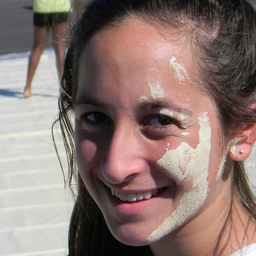 | 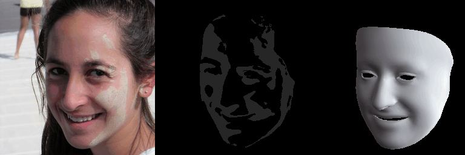 | 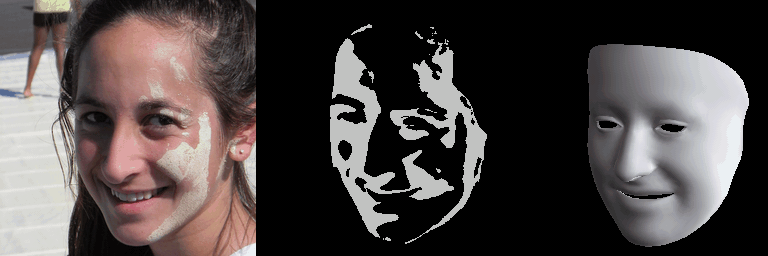 |
| 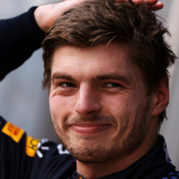 | 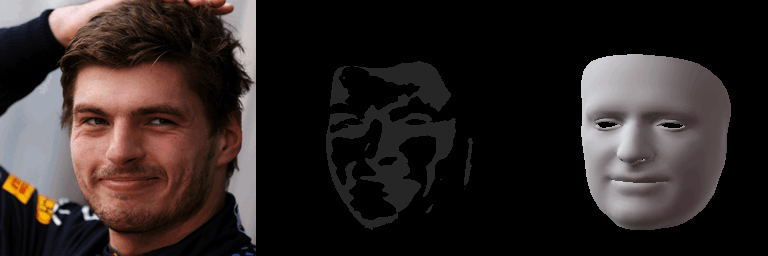 | 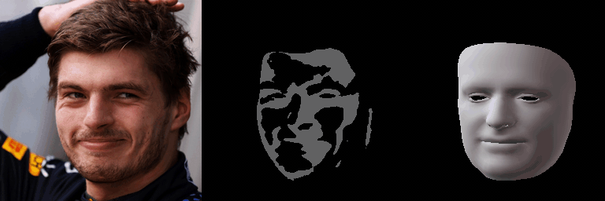 |

</div>

---

### 3.2 Rotate SH Lighting (`rotateSH`)

Rotates the 3D Spherical Harmonics (SH) lighting 360° around `--rotate_sh_axis` (`0`, `1`, or `2`) with controlled cast-shadow intensity (`--relight_with_given_c`):

```bash
python inference.py \
  --dataset_root ../../examples/dat/ \
  --set valid \
  --step 300000 \
  --out_dir ../../examples/res/relight/rotateSH_a2/ \
  --cfg_name DiFaReli++.yaml \
  --log_dir <path_to_ckpt>/DiFaReli++/ \
  --sample_pair_json ../../examples/pair.json \
  --itp_step 60 \
  --batch_size 1 \
  --gpu_id 1 \
  --rotate_sh \
  --rotate_sh_axis 2 \
  --relight_with_given_c 0.9 \
  --save_vid
```

#### 🖼️ Relighting with `RotateSH` Results

<div align="center">

| Input | Output & Conditioning (`Relit \| Shadow map \| Shading ref.`) |
| :---: | :---: |
|  | 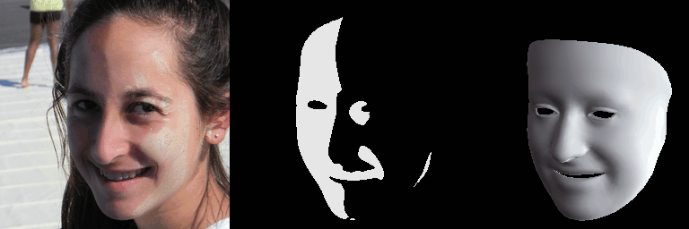 |
|  | 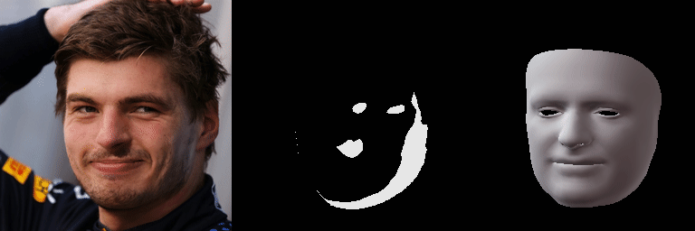 |

</div>

---

### 3.3 Target-SH Relighting (`targetSH`)

Relights a source portrait (`src`) by interpolating toward a target portrait's (`dst`) SH lighting and shadow scalar (`--relight_with_dst_c`):

```bash
python inference.py \
  --dataset_root ../../examples/dat/ \
  --set valid \
  --step 300000 \
  --out_dir ../../examples/res/relight/targetSH/ \
  --cfg_name DiFaReli++.yaml \
  --log_dir <path_to_ckpt>/DiFaReli++/ \
  --sample_pair_json ../../examples/pair.json \
  --sample_pair_mode pair \
  --itp_step 60 \
  --batch_size 1 \
  --gpu_id 2 \
  --relight_with_dst_c \
  --save_vid
```

#### 🖼️ Relighting with `TargetSH` Results

<div align="center">

| Input (`Src \| Dst`) | Output & Conditioning (`Relit \| Shadow map \| Shading ref.`) |
| :---: | :---: |
|   | 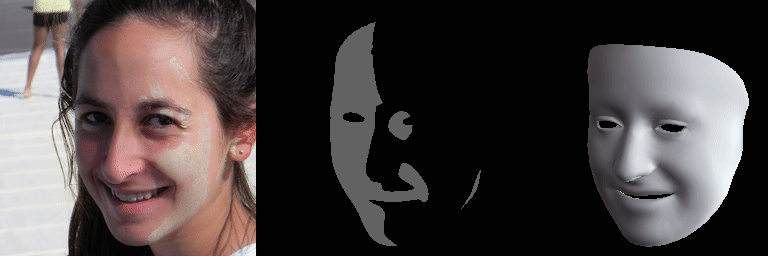 |
|   | 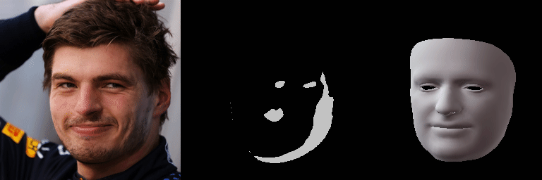 |

</div>

---

### 3.4 CLI Arguments & Output Structure

Single-subject modes (`reshadow/*`, `rotateSH_*`) save outputs to `<out_dir>/<src_stem>/`, while paired target-SH modes (`targetSH`) save to `<out_dir>/<src_stem>_to_<dst_stem>/`. Each folder contains `frames/` (`res_frame*.png`, `dst_ren_frame*.png`, `dst_shadm_shad_frame*.png`), `vid/` (`*.mp4`), and `res_desc.json`.

<details>
<summary><b>⚙️ Click to expand full <code>inference.py</code> CLI arguments & output directory tree</b></summary>

| Argument | Default | Description |
| :--- | :--- | :--- |
| **General (Dataset, Checkpoint & Output)** | | |
| `--dataset_root` / `--set` | *(Required)* | Preprocessed dataset root (`../../examples/dat/`) and split (`valid`, `train`, `test`) |
| `--log_dir` / `--cfg_name` / `--step` | *(Required)* | Checkpoint directory (`<path_to_ckpt>/DiFaReli++/`), config YAML (`DiFaReli++.yaml`), and step (`300000`) |
| `--sample_pair_json` | `None` | Path to JSON file specifying `src`/`dst` pairs |
| `--itp_step` / `--batch_size` | `15` / `15` | Number of relit frames and forward-pass sub-batch size |
| `--out_dir` / `--save_vid` / `--fps` | *(Req)* / `False` / `20` | Output directory, MP4 video export flag, and video frame rate |
| **Reshadowing Mode** | | |
| `--shadow_diff_inc_c` | `False` | Lock source shadow mask and linearly increase shadow scalar $C \to 1.0$ (strengthen shadow) |
| `--shadow_diff_dec_c` | `False` | Lock source shadow mask and linearly decrease shadow scalar $C \to 0.0$ (diffuse / remove shadow) |
| `--reshadow_with_given_c` | `None` | Override starting $C \in [0, 1]$ for reshadowing (defaults to $C_{\text{src}}$) |
| `--force_src_shading_for_reshadow` | `False` | Keep source SH shading fixed across frames (used with `--shadow_diff_inc_c`) |
| `--force_diffuse_shading_for_reshadow` | `False` | Use diffuse shading reference on target frames (used with `--shadow_diff_dec_c`) |
| `--itp_diffuse_sh` | `False` | Interpolate SH from source to diffuse shading reference (use with `--force_diffuse_shading_for_reshadow`) |
| **Relighting Mode (`rotateSH` & `targetSH`)** | | |
| `--rotate_sh` / `--rotate_sh_axis` | `False` / `2` | Rotate source SH lighting 360° around axis `0`, `1`, or `2` |
| `--relight_with_dst_c` | `False` | Scale target shadow map by destination subject's $C_{\text{dst}}$ |
| `--relight_with_given_c` | `None` | Scale target shadow map by a custom $C \in [0, 1]$ |
| `--relight_with_strongest_c` | `False` | Scale target shadow map by $C = 1.0$ |

```text
examples/res/
├── reshadow/
│   ├── shadow/{61992,max}/                  # Strengthen shadow (--shadow_diff_inc_c)
│   │   ├── frames/                          # res_frame*.png, {src,dst}_ren_frame*.png, {src,dst}_shadm_shad_frame*.png
│   │   ├── vid/                             # res{,_rt}.mp4, out{,_rt,_no1,_rt_no1}.mp4
│   │   └── res_desc.json
│   └── diffuse/{61992,max}/                 # Diffuse shadow (--shadow_diff_dec_c)
├── relight/
│   ├── rotateSH_a2/{61992,max}/             # Rotate SH lighting (--rotate_sh --rotate_sh_axis 2)
│   └── targetSH/{61992_to_max,max_to_61992}/# Paired Target-SH relighting (--relight_with_dst_c)
└── gifs/{reshadow,rotateSH,targetSH}/       # Showcase GIFs
```

</details>

---

## 4. Training

Please refer to **[TRAINING.md](TRAINING.md)** for the complete training guide (preparing shadow maps, training the DiFaReli++ diffusion model, generating the paired relit dataset, and training the single-shot model).
